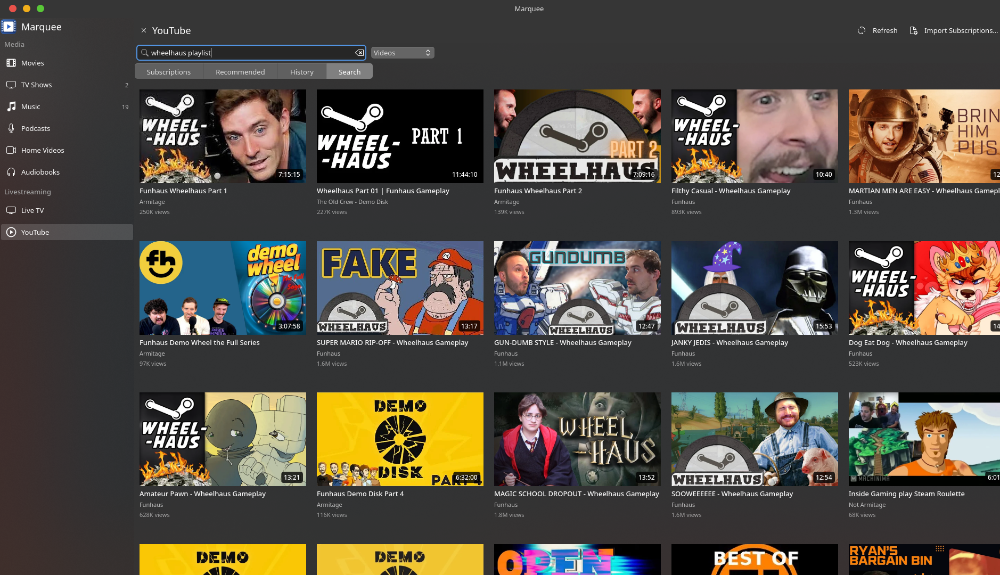
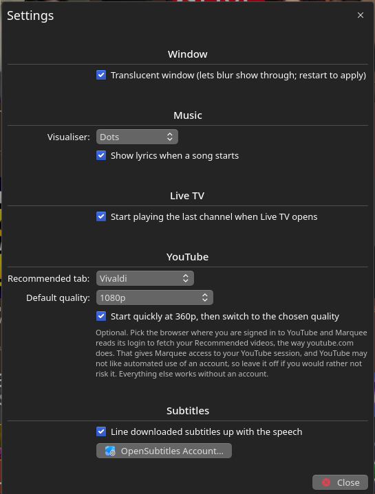
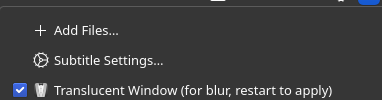

<p align="center"></p>
<h1 align="center">Marquee</h1>
<p align="center">One app for your own movies, TV and music, plus YouTube, YouTube Music, Shorts, Podcasts, Twitch and Live TV.<br>
Qt 6 + Kirigami. Native on KDE Plasma, and runs on any Linux desktop. A Windows build is planned.</p>

## Screenshots

| YouTube | Settings |
|---|---|
|  |  |



## Highlights

**Your own files**
- **Library:** Movies, TV Shows and Music, with cover art looked up online, resume where you left off, a Continue list, favourites, and grid or list views.
- **Music:** artist and album pages, lyrics that follow the song, a visualiser, and a mini player that keeps going while you browse.
- **Subtitles:** files beside the video, tracks inside it, automatic download from OpenSubtitles (Subdl as a backup) and automatic syncing to the speech.

**Online, no account needed**
- **YouTube:** search, channels, playlists, subscriptions (Google Takeout import), history, a quality menu with Auto, fast start, and SponsorBlock to skip sponsor reads.
- **YouTube Music:** songs, albums, artists and playlists in the same mini player, with lyrics and media keys. Needs the `requests` Python package.
- **YouTube Shorts:** a vertical feed with auto-scroll, a "For you" mix, and "More like this".
- **Podcasts:** search, subscribe by name, RSS link or Apple Podcasts link, resume where you stopped, and playback speed.
- **Live TV:** M3U playlists with an XMLTV guide, and the largest picture size the stream offers.

**With an account**
- **Twitch:** sign in with a code, see who you follow (live first, tiles or a list, with search), and watch at the size you pick. Commercial breaks play in full and the channel carries on after them. Needs your own free Twitch developer Client ID.

**Everything in one place:** all settings, including your subtitle keys, are in **Settings** (Ctrl+,). Marquee keeps a log file you can attach to a bug report.

## Download

Grab the latest build from the **Releases** page:

- **Linux:** `Marquee-x86_64.AppImage`. `chmod +x` it and run. Use a tool like Gear Lever to add it to your menu, or run it once with `--install-desktop` (and `--uninstall-desktop` to remove the entry). It uses your system's Qt 6 and Kirigami (see Install).

## Install from source

Python 3.10+ and Qt 6 with Kirigami.

| Distro | Packages |
|---|---|
| Arch | `pyside6 kirigami qqc2-desktop-style` |
| Fedora | `python3-pyside6 kf6-kirigami qt6-qtmultimedia` |
| Debian / Ubuntu | `python3-pyside6.qtquick python3-pyside6.qtmultimedia qml6-module-org-kde-kirigami qml6-module-qtquick-dialogs` (names vary) |

For YouTube also install `yt-dlp`, `deno`, `yt-dlp-ejs` and `ffmpeg` (`curl_cffi` is optional).

**New for YouTube Music:** it also needs the Python `requests` package. Most systems already have it; if YouTube Music
says it is missing, install it from your distro (the AppImage uses your system's Python, so this applies to it too):

| Distro | Package |
|---|---|
| Arch | `sudo pacman -S python-requests` |
| Fedora | `sudo dnf install python3-requests` |
| Debian / Ubuntu | `sudo apt install python3-requests` |

Nothing else is new to install. The catalogue library for YouTube Music (ytmusicapi) is bundled in the app.
Run with `python3 -m marquee`, or `pip install .[qt]`. `bash install-desktop.sh` adds the app icon to the Linux taskbar.

## Library features

Media (Movies, TV Shows, Music), Library / Continue / Favorites tabs,
search, grid and list views, adjustable cover size, drag and drop, folder import, file name
parsing (`Movie.1999.1080p.mkv`, `Show.S01E02.mkv`, `Artist - Song.mp3`), MP3 tags and embedded covers, cover
art lookup (iTunes Search API for movies and music; TVmaze for TV), manual cover choice, resume where you stopped (videos only; songs always start from the top), queue with next/previous, and
subtitles, and three built-in sample tracks so the player works on first launch.

**Media keys:** the keyboard's play/pause, next and previous keys, and your desktop's media widget, control Marquee through MPRIS. They act on the video or channel on screen, otherwise on the music player.

Keys in the player: Space or K play/pause, ←/→ seek 10 s, N / P next / previous, M mute, C subtitles, F fullscreen, Esc back.

## TV shows

Episodes are grouped as **Show → Seasons → Episodes**. In the Library tab a series is one tile; open it for
its seasons, open a season for its episodes. Playing an episode carries on through the rest of the series,
across seasons. Continue, Favorites and search stay flat, so a half-watched episode is one click away.

**Add a whole show at once.** Choose the show's own folder with Add Folder, and every season folder inside it
comes along. A folder with Season folders inside it is treated as the show, and its name is the show's name, so
episodes named differently from one season to the next still end up in one show. Season folders can be called
`Season 1`, `Season 01`, `S02`, `Series 3`, `Season 1 (1080p)`, `Ted.S04.1080p.WEB` or `Specials`. You can also
choose a folder that holds many shows, such as `TV/`, to add them all. Episode files can be named
`Show.S01E02.mkv`, `03 - Title.mkv`, `Episode 3.mkv` or just `03.mkv`. Specials with no number are kept, under
a Specials season. A `Specials` or `Extras` folder inside a movie folder is not mistaken for a show.

Files are recognised as `Show.S01E02.mkv`, `Show 1x02.mkv`, `Show (2024) S01E02 Title.mkv` and
`Show/Season 1/04 - Title.mkv`.

Every time you add a show, Marquee looks it up on TVmaze and fills in:

- the **real episode names** (a name you typed yourself in Edit Info is never overwritten),
- the **show poster**, used only on the show tile,
- a **poster for each season** that has one, used on that season's tile and its episodes. A season without
  its own art shows the show poster instead.

A season poster is never used as the show's poster. If TVmaze has no poster for a show, its tile stays a
plain placeholder rather than borrowing a season's art.

If the wrong show is matched, or nothing matched, right-click the show and choose **Change Match…**, then
type the title (add the year if needed, for example `Ted 2024`). **Find Episode Names and Artwork** on the
same menu refreshes a show that is already matched.

Episode names and TV artwork are from [TVmaze](https://www.tvmaze.com), licensed CC BY-SA 4.0.

## Moving around

Back, Forward and Home buttons sit at the left of the toolbar (Alt+Left, Alt+Right, Alt+Home, or the back and
forward buttons on your mouse). Back and Forward walk through where you have been, like a browser, including
tab and collection changes. Inside a show or an artist there is also an Up button for one level. The grid keeps its
scroll position when you come back from playing something.

**Search looks at the screen you are on.** On the main screen it finds shows, movies and artists, not their
episodes or songs. Inside a show it finds that show's episodes, inside an artist that artist's songs. On Continue
and Favorites it searches what is listed there. The search box says what it will search. Opening anything clears it.

**Continue.** On the Continue tab, **Clear Continue…** removes everything from the list, and a title's menu has
**Remove from Continue**. Both only forget where you stopped. Nothing is deleted.

## Adding folders

Pick a folder once and everything inside it is added.

- **TV:** a folder with Season folders inside it is the show (see TV shows below).
- **Movies:** `Movies/Heat (1995)/anything.mkv` is named from the folder, so messy file names are fine. Pick
  `Movies/` to add them all. `poster.jpg`, `folder.jpg` or `cover.jpg` in a movie's folder is used as its cover.
  `Extras`, `Featurettes`, `Samples`, `Trailers` and similar folders, and files ending in `-sample` or `-trailer`,
  are skipped. Pick one of those folders yourself if you do want it.
- **Music:** `Artist/Album/01 - Title.flac`, `Artist - Album/01 Title.mp3` and `Album/Disc 1/…` are all read.
  Tags (read with ffprobe, so install ffmpeg) name the songs, and the folders keep each album together. Music
  browses as **Artist → Album → Songs**, and a song plays on through the rest of its album, then the artist's
  later albums. `cover.jpg` or `folder.jpg` in an album folder is the album's cover.

## Subtitles

Press **C** or use the **CC** button in the player. Marquee offers, in this order:

- subtitle files beside the video with a matching name (`Movie.srt`, `Movie.en.srt`, or inside a `Subs/` folder),
- files you add with **Add Subtitle File…**, which are remembered for that video,
- text tracks stored inside the file (MKV, MP4 and others). These are read with `ffmpeg`, so install it.
  They are extracted once and cached in `~/.cache/marquee/subs/`.

**Music in the background.** Songs play in a player that belongs to the window, not to a page, so music carries on while you browse. A bar along the bottom shows the cover, title, shuffle, previous, play/pause, next, repeat, a seek bar and the volume; click the song (or the arrow) to open Now Playing, or the cross to stop. Starting a video stops the music.

**Shuffle and repeat.** Shuffle mixes the rest of the album and the artist's later albums, keeping the song you are on. Repeat goes off, all, then one. Both are remembered. Pressing Next always moves on, even under repeat one.

**Lyrics.** The Lyrics button (or **L**) on Now Playing shows them beside the cover. Timed lyrics are followed like karaoke: the line being sung fills from left to right, the rest are dim, the list scrolls with the song, and clicking a line jumps to it. Without timings they are plain text you scroll. They come from a `.lrc` file beside the song, lyrics stored in the file's tags, or LRCLIB (lrclib.net, free, no account; only the artist, title, album and length are sent). Results are cached, so each song is looked up once.

**Syncing.** Subtitles that start late or early are lined up on their own: ffmpeg listens for speech in the video, the app slides the subtitle over it to find the best fit (up to two minutes either way) and also tries the common frame-rate mismatches (23.976, 24 and 25 fps) for subtitles that drift as the film goes on. It runs once per subtitle track in the background, never for tracks inside the video file, and the timing it finds is remembered for that video. Use **Sync Subtitles to the Speech** in the CC menu to run it again, or turn the automatic run off there. Without ffmpeg nothing is synced; **Show Earlier / Later** still works.

**Downloading.** Open **Settings** (Ctrl+,), go to Subtitles, and enter the API key, username and password of a free
[OpenSubtitles.com](https://www.opensubtitles.com) account (the key is under Profile › API consumers). When a
video has no subtitles, Marquee then looks one up automatically, once per video, and saves it as
`Movie.en.srt` beside the video (or in `~/.cache/marquee/subs/` if that folder is read-only). Matching uses a hash
of the file first, then the show, season and episode or the movie title and year. **CC › Download Subtitles** does
it on demand. Your key and login are stored in `~/.local/share/marquee/opensubtitles.json`, readable only by you.

**Backup source (Subdl).** Optionally add a free API key from [subdl.com](https://subdl.com) in the same Subtitles section of Settings. Marquee asks
OpenSubtitles first and tries Subdl when it finds nothing for that episode or movie, or can't be used (for example, the
daily download limit was reached). Shows are searched by their IMDb number, so a remake with the same name is never
confused with the original. The key is stored in the same private file.

Formats: `.srt`, `.vtt`, `.ass` and `.ssa` (shown as plain text, without ASS styling). Picture-based tracks (PGS,
VobSub) cannot be shown; the CC menu says so. English is chosen first when several are available, and your
choice, timing offset and text size are remembered. Timing moves subtitles in 0.5 s steps.

## Artist pages (Qt frontend)

Opening an artist in Music shows all of their albums on one page, one after another: the cover, the album's name and
length, and a numbered list of its songs. Click a song to play it (the rest of the artist's songs follow in the order
on screen), right-click for the usual menu, or use **Play** / **Shuffle** at the top, or the round play button on an
album. The song that is playing is highlighted. Searching inside an artist still gives a plain list of matching songs.

## YouTube (Qt frontend)

Choose **YouTube** in the sidebar. It works like FreeTube: no account, nothing is sent to Google about you beyond
what a normal video request needs. Search videos or channels, subscribe to channels (kept on this computer), see a
feed of their latest videos, and keep a watch history. Videos play in Marquee's own player.

It needs **yt-dlp** installed (`sudo pacman -S yt-dlp`). Streams are the combined video+audio formats YouTube offers,
usually up to 720p.

**Import your subscriptions:** use the toolbar's *Import Subscriptions…* and pick `subscriptions.csv` from a Google
Takeout export (YouTube and YouTube Music › subscriptions). Channels already subscribed are skipped.

**Quality:** the player has a quality menu (Auto, 1080p, 720p, 480p, 360p); Settings › YouTube sets the default.
360p starts instantly. Higher qualities need yt-dlp to download and join the separate video and sound streams first
(progress is shown). Auto picks the best quality it expects to download in about 20 seconds, from the speed it
measured last time. Qt can't change quality mid-play, so picking another one restarts at the same spot. YouTube also
needs **deno** and **yt-dlp-ejs** installed.

**Recommended tab (optional):** in Settings › YouTube pick the browser you are signed in to YouTube with. Marquee
then reads that browser's login through yt-dlp to fetch your home-page recommendations. This hands Marquee your
YouTube session and YouTube may flag automated use, so it is off by default.

### SponsorBlock

YouTube videos skip the parts the [SponsorBlock](https://sponsor.ajay.app) community has marked, and the corner of the player
says what was skipped. In **Settings › SponsorBlock** turn it on or off and choose which kinds to skip: sponsors,
self-promotion and like-and-subscribe reminders (the default), plus intros, outros, previews and recaps, filler, and the
non-music parts of music videos. Only a short code made from a hash of the video's ID is sent to look the parts up.
If you seek back into a skipped part, it is not skipped a second time. SponsorBlock data is licensed
[CC BY-NC-SA 4.0](https://creativecommons.org/licenses/by-nc-sa/4.0/) and belongs to its contributors.

## YouTube Music (Qt frontend)

Choose **YouTube Music** in the sidebar. Search songs, albums, artists and playlists with no account; album and artist
pages look like the Music tab, and songs play in the mini player with the visualiser, lyrics and media keys. Lyrics come
from YouTube Music itself when it has them, otherwise from LRCLIB, matched to the length of the audio so the timing
fits; if a song is still early or late, **[** and **]** nudge the lyrics by 0.1 s and the arrows by the Lyrics button by
0.5 s, remembered for that song. The next song is looked up while the current one plays, so it starts quickly.

It uses the same `yt-dlp` setup as YouTube, plus the `requests` package (see Install).

## YouTube Shorts (Qt frontend)

Choose **Shorts** in the sidebar for a vertical feed. Videos play one at a time and the next two load ahead of you, so
swiping on is quick. **Auto-scroll** moves to the next Short when one ends. **For you** mixes recent videos from
channels you subscribe to with, if you picked a browser under Settings › YouTube, YouTube's own recommendations.
**More like this** starts a feed based on the Short you are watching.

## Podcasts (Qt frontend)

Choose **Podcasts** in the sidebar. Search by name, or paste an RSS link or an Apple Podcasts link, and subscribe.
Your subscriptions list their latest episodes. Marquee remembers where you stopped in each episode, offers playback
speeds, and keeps playing while you browse (the player is the same bar as for music).

## Twitch (Qt frontend)

Choose **Twitch** in the sidebar.

1. Make a free application at [dev.twitch.tv/console](https://dev.twitch.tv/console) (Client Type: Public, OAuth
   Redirect URL `http://localhost`). Every app that signs in with Twitch needs one, so Marquee asks for yours.
2. Paste its Client ID into Marquee and press **Sign in with Twitch**. You get a short code to type at
   twitch.tv/activate; no password goes through Marquee.
3. **Live now** shows who you follow that is streaming, most viewers first; everyone else is listed under **Offline**
   with their picture. The button next to refresh switches between tiles and a list, and a search box appears when you
   follow many channels. You can also type any channel name or paste a twitch.tv link to watch it without signing in.

Pick the picture size (Best, 1080p, 720p, 480p, 360p) in the player or in the Twitch settings. Twitch puts commercial
breaks into the video; Marquee plays a break in full as its own video and then goes back to the channel. There is an
optional **ad-free mode** that asks for the stream through a proxy address you supply. It depends on someone else's
server, is against Twitch's terms, can stop working at any time, and Marquee falls back to the normal stream and says
so when it does. You can also let it use your browser's Twitch login (for Turbo or a subscription).

## Live TV (Qt frontend)

Choose **Live TV** in the sidebar, then **Add a Playlist…**: paste the M3U link from your IPTV provider (or pick a
`.m3u` file). The TV guide comes from an XMLTV link, which many playlists name in their own header; if yours does not,
paste one into the *TV guide* field. `.xml.gz` guides work, and only the next day and a half for your own channels is
kept, so even a huge national guide stays small.

- The top half shows the selected channel: its number and logo, what is on (with a progress bar and "Next"), and a
  live preview. Buttons: favourite, channel down/up, programme details, watch full size.
- The **Guide** below is the scrolling timetable. Click a channel or a programme to select it and start the preview;
  click the preview (or double-click a channel) to watch full size. Pills filter by group (and *Favourites*), the
  search box is in the toolbar. Wheel scrolls channels; Shift+wheel, the arrows, **Now**, **Tonight 8 PM** and
  **Tomorrow morning** move through time.
- Press **Esc** or **Guide** while watching to go back to the guide with that channel still playing in the preview.
- While watching: **Up/Down** (or **N/P**) change channel, and a *LIVE* panel shows what is on and what is next.
- Channels are matched to the guide by `tvg-id`, then by name (so `BBC One HD` finds `BBC One`). The channel list
  and guide are refreshed when older than a day / twelve hours, or with **Refresh Channels and Guide**.
- Playlists and favourites are in `~/.local/share/marquee/iptv.json`; the cache is in `~/.cache/marquee/iptv/`.
- Xtream Codes logins are not supported; use the M3U link your provider gives you instead.

## Log file

Marquee keeps a copy of everything it prints in `~/.local/share/marquee/marquee.log` (the previous run is kept as `marquee.log.1`). If something misbehaves, attach that file to a bug report.

## KDE: blur and the WhiteSur theme

On Plasma the window is translucent, so a blur effect can show through it. Panes use your colour scheme's own
window colour (WhiteSur light or dark, or any other) at about 55 to 80 percent opacity, and the video page stays
solid. Marquee does not blur by itself. KWin does, and these steps work with the stock Blur effect or with
[Better Blur DX](https://github.com/xarblu/kwin-effects-better-blur-dx):

1. Install and enable the effect: System Settings › Window Management › Desktop Effects.
2. Tell it to blur Marquee. For Better Blur DX, open its settings and add the window class
   `io.github.marquee.Marquee` to the force-blur list. For the stock Blur effect, use the "Force blur"
   option or a window rule for the same class. To check the class, hold Alt+F3 on the window, or run
   `qdbus org.kde.KWin /KWin org.kde.KWin.queryWindowInfo` and click the window.
3. If the window shows no transparency, make sure the compositor is on and restart Marquee.

Turn the translucency off from the main menu (**Translucent Window**, restart to apply) if you prefer a solid window.

## Run as an AppImage

```
sh packaging/build-appimage.sh            # downloads appimagetool once, writes packaging/build/Marquee-*.AppImage
sh packaging/build-appimage.sh --appdir   # or just build packaging/build/Marquee.AppDir and run its AppRun
```

The AppImage does not bundle Python or Qt. It runs on your system's own so that it follows your desktop theme.
Install the packages from the Install section first.

## Credits

Episode names and TV artwork: [TVmaze](https://www.tvmaze.com) (CC BY-SA 4.0). Lyrics: [LRCLIB](https://lrclib.net) and
YouTube Music. Subtitles: [OpenSubtitles](https://www.opensubtitles.com) and [Subdl](https://subdl.com). Skip data:
[SponsorBlock](https://sponsor.ajay.app) (CC BY-NC-SA 4.0). YouTube Music catalogue access:
[ytmusicapi](https://github.com/sigma67/ytmusicapi) by sigma67 (MIT; a copy is bundled in `marquee/_vendor` with its
licence). Marquee is not affiliated with or endorsed by YouTube, Google or any of these services, and they can change
or stop working without notice.

## Notes

- The Qt app has the Now Playing screen for music: the album art in the middle, a backdrop of slowly drifting glows in the art's own colours (dynamic colour, as on Apple Music and Spotify), and visualiser bars underneath (Bars, Mirror, Wave, Dots, Scope or Off, from the drop-down by the speed control). The levels are read from the file with `ffmpeg`, so install ffmpeg for the bars to move (without it they rest flat); `numpy` makes it lighter on the CPU but is optional.
- Format support comes from the system: Qt Multimedia (FFmpeg backend).

## Layout

```
marquee/core/    library, parsing, ID3, cover lookup, desktop detection. No Qt imports.
marquee/qt/      controller.py (model + slots) and qml/ (Main, LibraryPage, PlayerPage, Cover)
tests/           unit tests for the core: python3 -m unittest discover -s tests
```

Data lives in `~/.local/share/marquee/` (library.json, covers/, samples/).
